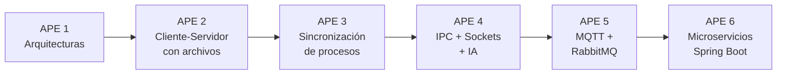
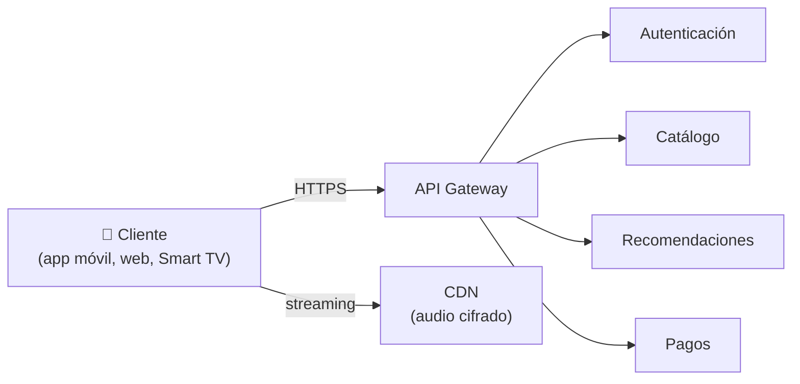
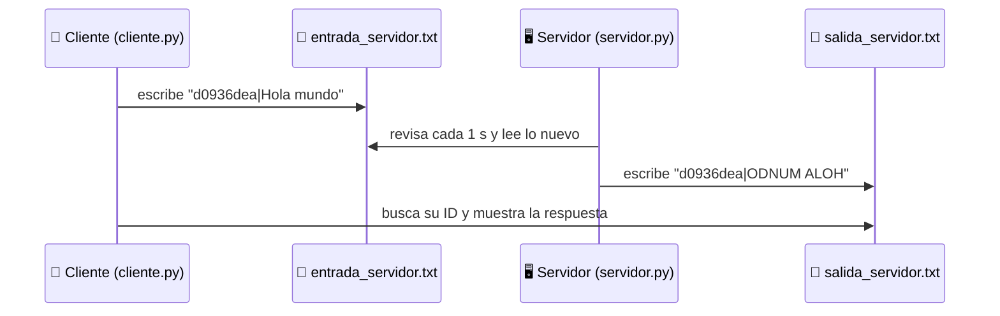
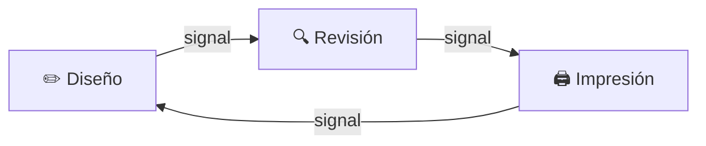
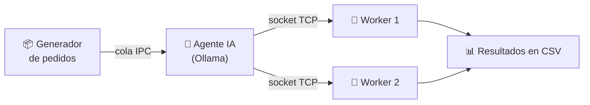
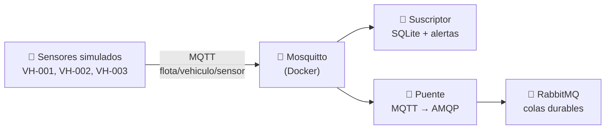
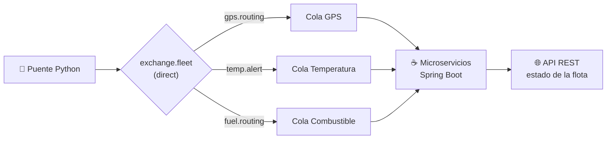

# 📚 Portafolio de Sistemas Distribuidos

**Estudiante:** María Elizabeth Chuico Medina
**Asignatura:** Sistemas Distribuidos (6.º ciclo "A")
**Carrera:** Computación (FEIRNNR), Universidad Nacional de Loja
**Docente:** Ing. José O. Guamán Q.
**Período:** septiembre a octubre de 2026

Este repositorio reúne las **Actividades Práctico-Experimentales (APE)** que hice durante el ciclo. Cada APE tiene un informe en PDF, y algunas incluyen código fuente.

---

## 🤔 ¿Qué es un sistema distribuido?

Un **sistema distribuido** es un conjunto de programas o computadoras que trabajan juntos y se comunican enviándose **mensajes**. Para quien lo usa, todo funciona como si fuera un solo sistema.
Algunos ejemplos cotidianos son Netflix, Spotify, WhatsApp y la banca en línea.

En las prácticas se avanza paso a paso:



---

## 🗂️ Índice rápido: ¿dónde está cada cosa?

| APE | Tema | Modalidad | Documento | Código |
|:---:|------|:---------:|-----------|--------|
| 1 | Arquitecturas de sistemas distribuidos | Grupal | [APE1.pdf](APE1.pdf) | No aplica |
| 2 | Comunicación cliente-servidor mediante archivos | Individual | [APE2/AP2_ChuicoMaria.pdf](APE2/AP2_ChuicoMaria.pdf) | [APE2/](APE2/) (en este repositorio) |
| 3 | Sincronización: mutex, semáforos y concurrencia | Grupo 4 | [APE3_Grupo4.pdf](APE3_Grupo4.pdf) | [Repositorio del grupo](https://github.com/Carlosjosu/APE-3-Sistemas-distribuidos) |
| 4 | Colas IPC, sockets TCP y agente de IA | Grupo 4 | [APE4_Grupo4.pdf](APE4_Grupo4.pdf) | [Repositorio del grupo](https://github.com/Michu117/Mecanismos-de-Comunicacion-InterProceso-IPC-yRed) |
| 5 | Mensajería IoT con MQTT y RabbitMQ (Parte 1) | Grupo 4 | [APE5_Grupo4.pdf](APE5_Grupo4.pdf) | Incluido en el informe |
| 6 | Microservicios con RabbitMQ y Spring Boot (Parte 2) | Grupo 4 | [APE6_Grupo4.pdf](APE6_Grupo4.pdf) | [Repositorio del grupo](https://github.com/Michu117/APE-6-Sistemas-Distribuidos) |

> 👥 **Grupo 4:** María Chuico, Carlos Granda, Fabricio Ruiz y Juan Veintimilla.

```
Portafolio_SistemasDistribuidos_MariaChuico/
├── README.md                ← este archivo
├── APE1.pdf
├── APE2/
│   ├── AP2_ChuicoMaria.pdf  ← informe de la APE 2
│   ├── cliente/cliente.py
│   ├── servidor/servidor.py
│   ├── servidor/estado_servidor.txt
│   └── comunicacion/        ← "canal" compartido (archivos de texto)
│       ├── entrada_servidor.txt
│       └── salida_servidor.txt
├── APE3_Grupo4.pdf
├── APE4_Grupo4.pdf
├── APE5_Grupo4.pdf
└── APE6_Grupo4.pdf
```

---

## 🏛️ APE 1: Análisis colaborativo de las arquitecturas principales

📄 **Documento:** [APE1.pdf](APE1.pdf)  ·  📅 29 de septiembre y 2 de octubre de 2026

**¿Qué se hizo?**
En equipo, investigamos y comparamos las cuatro arquitecturas básicas de un sistema distribuido. Llenamos una **matriz comparativa** con la estructura, las ventajas, las desventajas, la escalabilidad y ejemplos reales de cada una. Después aplicamos lo aprendido a un **caso de estudio: Spotify**.

| Arquitectura | Idea principal (en simple) | Ejemplo real |
|---|---|---|
| **Cliente-Servidor** | Un servidor central atiende las peticiones de muchos clientes. | Netflix, tiendas en línea |
| **Peer-to-Peer (P2P)** | Todos los equipos son iguales y comparten recursos entre sí, sin un servidor central. | BitTorrent, Bitcoin |
| **Multicapa (N-tier)** | La aplicación se divide en capas (presentación, lógica y datos) y cada capa tiene su función. | Sistemas de matrícula, banca web |
| **Microservicios** | La aplicación se divide en servicios pequeños e independientes que se comunican por medio de APIs. | Spotify, Uber, Amazon |

**Caso de estudio: Spotify**



**Conclusión clave:** ninguna arquitectura es "la mejor". La elección depende del problema. Por ejemplo, P2P sigue funcionando aunque se caiga un nodo, y la arquitectura multicapa facilita hacer cambios sin afectar a todo el sistema.

---

## 📨 APE 2: Comunicación cliente-servidor mediante archivos *(individual)*

📄 **Documento:** [APE2/AP2_ChuicoMaria.pdf](APE2/AP2_ChuicoMaria.pdf)  ·  💻 **Código:** [APE2/](APE2/)  ·  📅 6 al 9 de octubre de 2026

**¿Qué se hizo?**
Programé en **Python** un **servidor** y un **cliente** como dos proyectos separados. Ninguno conoce el código del otro. Se comunican solo a través de **dos archivos de texto**, que hacen de "buzón" compartido:

- El cliente escribe su mensaje en `entrada_servidor.txt` con el formato `id|mensaje`.
- El servidor revisa ese archivo cada segundo, convierte el mensaje a **MAYÚSCULAS**, lo **invierte** y escribe la respuesta en `salida_servidor.txt`.



**Resultados (4 de 4 mensajes correctos):**

| Mensaje enviado | Respuesta del servidor |
|---|---|
| Hola mundo | ODNUM ALOH |
| Sistemas Distribuidos | SODIUBIRTSID SAMETSIS |
| Universidad Nacional de Loja | AJOL ED LANOICAN DADISREVINU |
| cliente servidor con archivos | SOVIHCRA NOC RODIVRES ETNEILC |

**Pruebas adicionales:** el servidor arranca bien con los archivos vacíos. Si el servidor está apagado, el cliente avisa después de 10 s y su mensaje queda guardado. Al reiniciar el servidor, este no repite respuestas porque guarda los IDs ya procesados en `estado_servidor.txt`.

**▶️ Cómo ejecutarlo** (en dos terminales):

```bash
# Terminal 1: servidor
cd APE2/servidor
python servidor.py

# Terminal 2: cliente
cd APE2/cliente
python cliente.py "Hola mundo"
```

**Aprendizaje clave:** el cliente y el servidor están **desacoplados**, es decir, solo comparten un "contrato" (las rutas y el formato `id|texto`). Este modelo es sencillo, pero tiene limitaciones frente a uno real, que usaría sockets o colas de mensajes.

---

## 🚦 APE 3: Sincronización de procesos (exclusión mutua, semáforos y concurrencia)

📄 **Documento:** [APE3_Grupo4.pdf](APE3_Grupo4.pdf)  ·  💻 **Código:** [repositorio del grupo](https://github.com/Carlosjosu/APE-3-Sistemas-distribuidos)  ·  📅 6 al 9 de octubre de 2026

**¿Qué se hizo?**
Cuando varios **hilos** (tareas que se ejecutan al mismo tiempo) usan un mismo recurso, pueden "chocar" entre sí. Resolvimos 5 situaciones de la vida real con herramientas de sincronización:

| # | Situación | Herramienta | Resultado verificado |
|:-:|---|---|---|
| 1 | 🚗 Estacionamiento con 4 espacios y 10 autos | Semáforo contador | Nunca hubo más de 4 autos dentro a la vez |
| 2 | 🏧 Cajero: dos retiros y un depósito sobre una misma cuenta de $1000 | Mutex (candado) | El saldo final siempre es $650 |
| 3 | 🏭 Fábrica: productores y consumidores con un almacén de 5 piezas | Semáforos + mutex | El almacén nunca se desborda ni queda inconsistente |
| 4 | 🌉 Puente de un solo sentido a la vez | Mutex + contadores | Nunca cruzan autos en sentidos opuestos, y ninguna dirección se adueña del puente |
| 5 | 🖨️ Imprenta: Diseño → Revisión → Impresión | Semáforos en cadena | Las etapas siempre se ejecutan en el orden correcto |



**Aprendizaje clave:** el **mutex** protege un recurso para que solo un hilo lo use a la vez. El **semáforo** coordina *cuántos* hilos pueden pasar o *en qué orden* lo hacen. También estudiamos el **interbloqueo (deadlock)** y sus cuatro condiciones de Coffman.

---

## 🛵 APE 4: Asignación de pedidos con colas IPC, sockets TCP y un agente de IA

📄 **Documento:** [APE4_Grupo4.pdf](APE4_Grupo4.pdf)  ·  💻 **Código:** [repositorio del grupo](https://github.com/Michu117/Mecanismos-de-Comunicacion-InterProceso-IPC-yRed)  ·  📅 13 al 16 de octubre de 2026

**¿Qué se hizo?**
Simulamos un sistema de **delivery**. Un programa central genera pedidos y los pasa internamente por **colas IPC** (comunicación entre procesos de una misma computadora). Luego los envía por la red con **sockets TCP** a dos *workers* (repartidores). Un **agente de IA local (Ollama)** decide a qué worker asignar cada pedido según su **carga** y su **distancia**.



**Resultados:** la comunicación IPC y TCP funcionó correctamente, y las decisiones y los tiempos se guardaron en archivos CSV. Cuando el servidor de IA no respondió, el sistema usó un **método alternativo** y siguió asignando pedidos. Esto demuestra que el sistema **tolera fallos**.

**Aprendizaje clave:** la IA aporta valor cuando hay muchos pedidos y condiciones variadas. En casos simples, unas reglas fijas son suficientes y más rápidas.

---

## 📡 APE 5: Mensajería distribuida con MQTT y RabbitMQ (Parte 1: capa IoT)

📄 **Documento:** [APE5_Grupo4.pdf](APE5_Grupo4.pdf)  ·  📅 20 al 23 de octubre de 2026

**¿Qué se hizo?**
Construimos la parte "IoT" de un sistema de **monitoreo de una flota de camiones**:

1. Levantamos un **broker MQTT (Mosquitto)** en **Docker**. El broker funciona como una "oficina de correos" que recibe y reparte mensajes.
2. Creamos un **simulador de sensores** en Python que envía el GPS, la temperatura y el combustible de 3 vehículos.
3. Hicimos un **suscriptor** que guarda los datos en **SQLite** y genera **alertas** si la temperatura pasa de 4 °C o el combustible baja del 20 %.
4. Programamos un **servicio puente** que reenvía el GPS y las alertas a **colas de RabbitMQ**.



**Aprendizaje clave:** **MQTT** es ligero e ideal para sensores. **RabbitMQ (AMQP)** es confiable para el procesamiento interno, porque guarda los mensajes hasta que alguien los consume.

---

## 🧩 APE 6: Microservicios con RabbitMQ y Spring Boot (Parte 2)

📄 **Documento:** [APE6_Grupo4.pdf](APE6_Grupo4.pdf)  ·  💻 **Código:** [repositorio del grupo](https://github.com/Michu117/APE-6-Sistemas-Distribuidos)  ·  📅 27 al 30 de octubre de 2026

**¿Qué se hizo?**
Continuamos la APE 5 y agregamos **microservicios en Java (Spring Boot)** que consumen las colas de RabbitMQ:

- Configuramos un *exchange* `exchange.fleet` de tipo **direct** con tres rutas: `gps.routing`, `temp.alert` y `fuel.routing`.
- Los consumidores en Spring Boot procesan el GPS y generan **alertas** de temperatura y combustible.
- Una **API REST** permite consultar el estado de la flota (probada con Postman).



🎥 **Videos de explicación:** [María Chuico](https://youtu.be/AjIIbLktyEg) · [Carlos Granda](https://youtu.be/Sa2Ght43llI) · [Fabricio Ruiz](https://youtu.be/a_-AQZLY45g) · [Juan Veintimilla](https://youtu.be/M5HxXiuAGWU)

**Aprendizaje clave:** al separar el sistema en servicios que se comunican por mensajes, cada parte puede crecer, fallar o cambiar sin afectar a las demás.

---

## 🛠️ Tecnologías utilizadas

| Categoría | Herramientas |
|---|---|
| Lenguajes | Python, Java (JDK 17) |
| Frameworks y librerías | Spring Boot, Spring AMQP, paho-mqtt, pika |
| Mensajería | MQTT (Mosquitto), AMQP (RabbitMQ), sockets TCP, colas IPC |
| Infraestructura | Docker, Docker Compose |
| Datos | SQLite, archivos CSV y TXT |
| Inteligencia artificial | Ollama (modelo local) |
| Otras | Visual Studio Code, Postman, draw.io, Git y GitHub |

---

## 📖 Mini glosario

- **Cliente / servidor:** quien pide un servicio / quien lo atiende.
- **Nodo:** cada computadora o programa que forma parte del sistema.
- **Hilo:** una tarea que se ejecuta al mismo tiempo que otras dentro de un programa.
- **Mutex / semáforo:** "candados" y "contadores de permisos" que ordenan el acceso a un recurso compartido.
- **Socket:** el "enchufe" que permite que dos programas se comuniquen por la red.
- **Broker:** el intermediario que recibe los mensajes y los entrega a quien corresponde.
- **Microservicio:** un programa pequeño que hace una sola tarea y se comunica con los demás.
- **API REST:** una forma estándar de pedir datos a un servicio a través de direcciones web.
